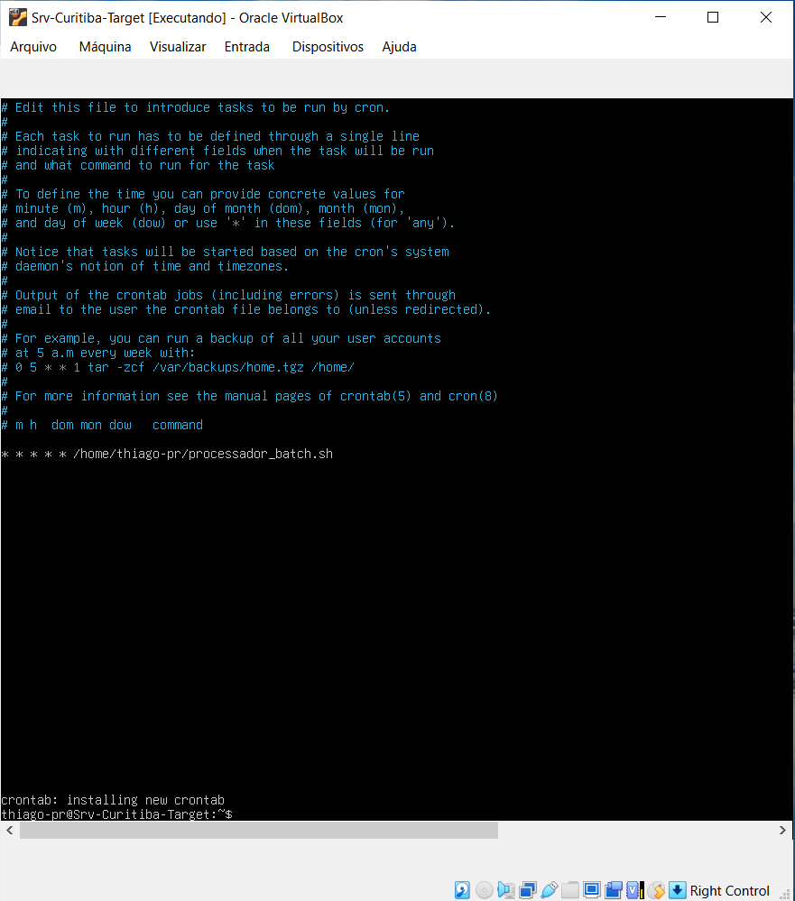
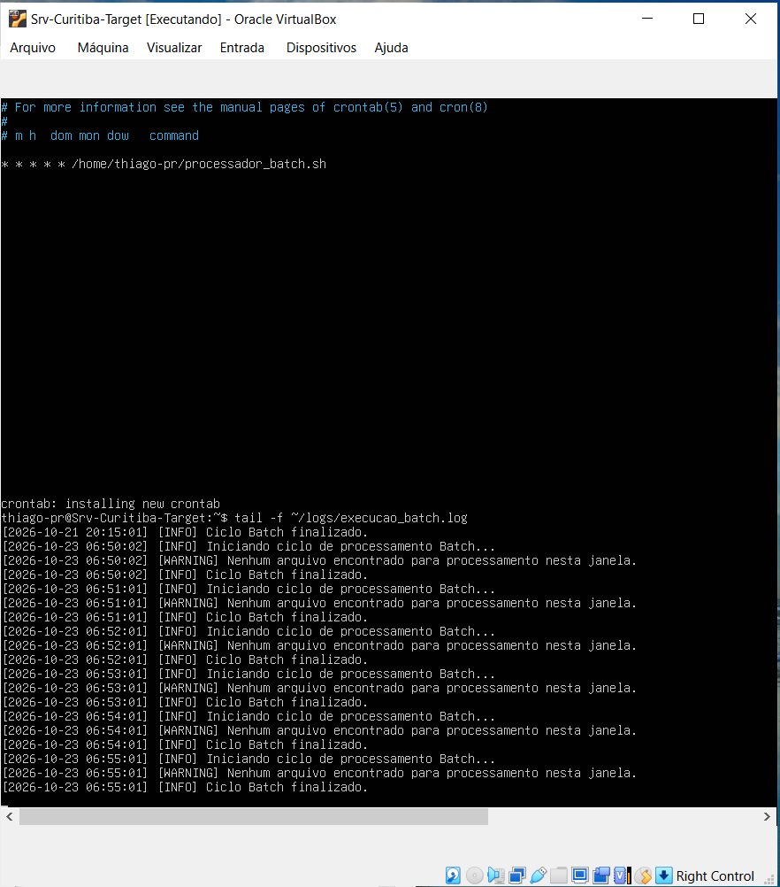
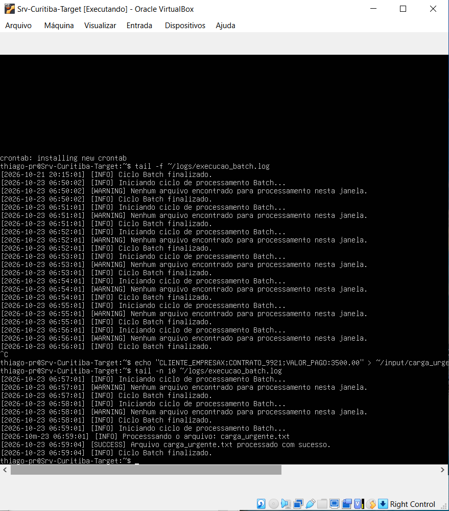
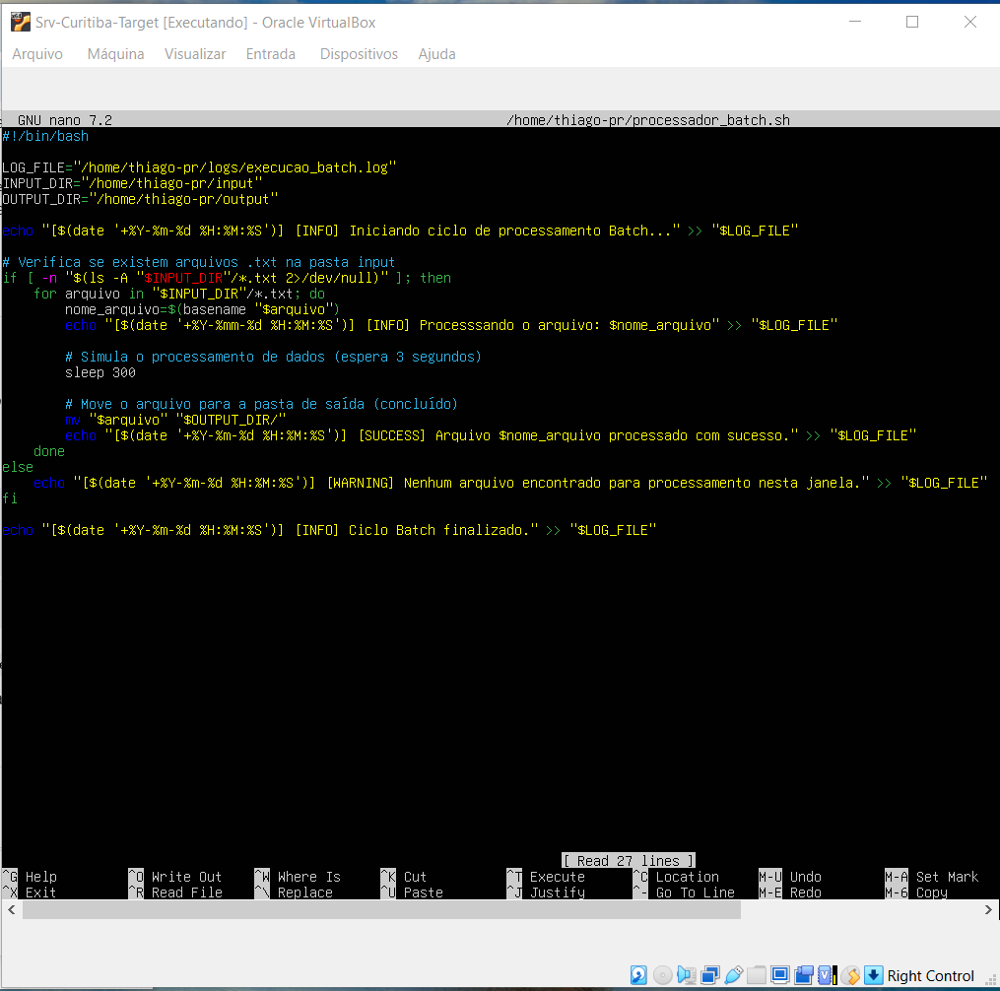
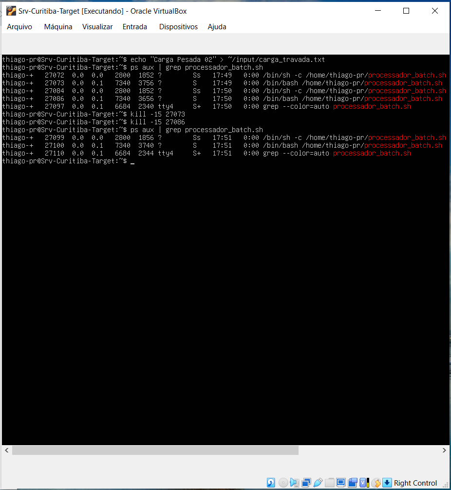
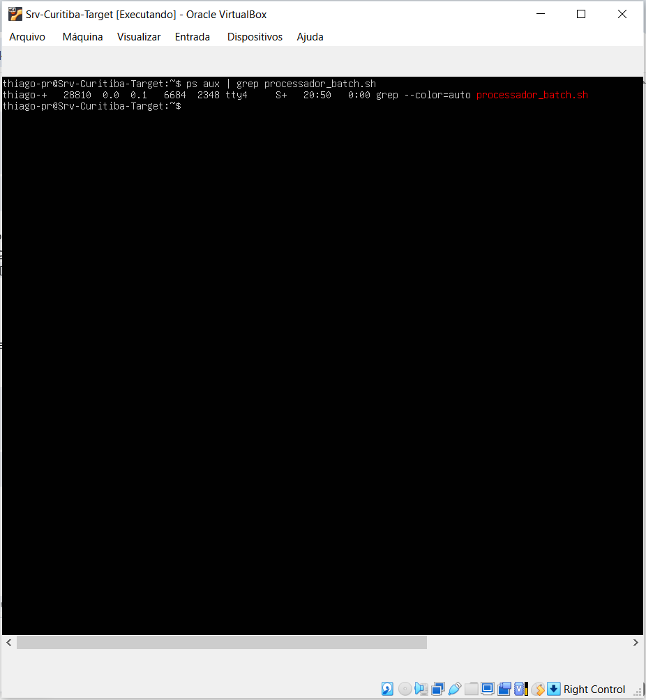
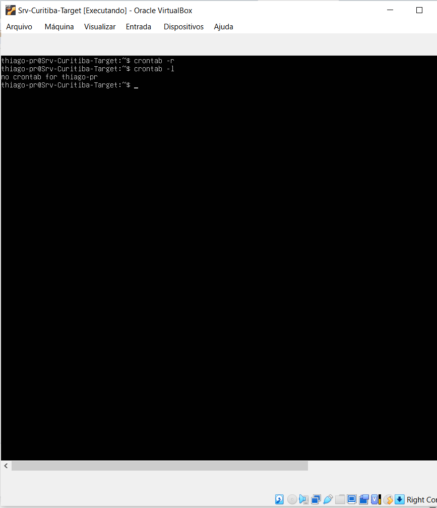

# ⚙️ Estudo de Caso: Simulação da Rotina do Operador de Produção (TI)

Este repositório documenta uma simulação prática e realista do dia a dia de um **Operador de Produção de TI**, focado em engenharia de sustentação de sistemas, conformidade de janelas operacionais (SLAs) e resolução de incidentes críticos em ambiente Linux corporativo.

O projeto demonstra a capacidade analítica de monitorar ecossistemas em lote (Batch), realizar manutenções preventivas manuais e aplicar técnicas forenses de terminal para solucionar travamentos e retenções de barramento de servidores.

---

## 📋 Cenário A: Resolução de Atrasos na Esteira (Carga Urgente Manual)

Quando o monitoramento centralizado aponta ausência de dados gerando alarmes sucessivos em lote, cabe ao operador intervir se houver um plano de contingência documentado para não estourar a janela operacional da companhia.

1. **Configuração da Automação Contínua:** O gatilho temporal foi configurado no daemon do Cron para processar em intervalos de um minuto, garantindo escuta permanente no ambiente:

2. **Monitoramento de Rotina Ativo:** O monitoramento contínuo via `tail -f` exibe os ciclos varrendo a pasta sem encontrar novos lotes, gerando o status controlado de `[WARNING]`:

3. **Injeção e Resolução de SLA:** Uma carga emergencial (`carga_urgente.txt`) foi injetada manualmente no diretório de entrada. O robô em lote pescou o lote de forma autônoma, processou-o e gerou o log de auditoria `[SUCCESS]`, limpando a área de entrada:

---

## 🚨 Cenário B: Caça e Depuração de Processos Travados (Loops Operacionais)

Em cenários severos, queries pesadas de banco de dados ou loops internos podem congelar scripts em execução. O operador de produção precisa identificar e derrubar os gargalos para liberar o barramento do servidor.

1. **Simulação de Gargalo de Rede/Banco:** O script foi alterado via editor de terminal para reter o processo por 300 segundos (`sleep 300`), represando a fila de processamento intencionalmente:

2. **Engenharia Forense de Processos (Derrubada com Kill):** Ao identificar o represamento e o acúmulo de instâncias concorrentes devido ao tempo de trava, executou-se uma busca profunda utilizando o utilitário de sistema `ps aux | grep`. Localizados os identificadores exclusivos, aplicou-se o sinal de encerramento controlado `kill -15` para purgar a fila de execução com segurança:

---

## 🧹 Encerramento do Turno & Governança de Infraestrutura

Uma das responsabilidades críticas de um Operador de TI na passagem e finalização de turnos é garantir a governança e o "decommissioning" (desativação) de rotinas e tarefas temporárias. Isso impede o desperdício de memória e o acúmulo de lixo técnico nos servidores de produção.

Ao concluir todas as validações práticas e testes de estresse das janelas batch, o ambiente foi purgado de forma segura através dos seguintes procedimentos:

1. **Auditoria Forense de Processos Ativos:** Foi realizada uma varredura profunda com o comando `ps aux | grep` para certificar que nenhuma instância zumbi ou travada ficou retida na memória do sistema operacional. O barramento de processos retornou totalmente limpo:

2. **Desativação Total do Agendador Crontab:** Para garantir que a esteira batch não executasse fora da janela permitida, limpou-se permanentemente o arquivo de tarefas do daemon com o comando `crontab -r`. A listagem via `crontab -l` ratificou o desligamento seguro:

Com estes procedimentos executados e devidamente evidenciados nos registros de auditoria, o turno de sustentação foi encerrado com sucesso, mantendo o ecossistema e o servidor em estado perfeitamente estável e limpo.
